  

 

  
  
  
  

<h1 align="center">Hola, soy Marco Antonio Canux Raquec</h1>

  <strong>Técnico en Desarrollo de Software · Frontend con JavaScript y Backend con Node.js</strong>

  Técnico en Desarrollo de Software formado en <strong>Campuslands (Guatemala)</strong>. Construyo interfaces limpias y responsivas con HTML, CSS y JavaScript, y APIs REST y aplicaciones de consola con <strong>Node.js, Express y MySQL</strong>. Me interesa escribir código ordenado por capas, aplicar principios SOLID y patrones de diseño, y documentar cada proyecto para que otra persona pueda instalarlo y entenderlo sin ayuda.

  

  <a href="#sobre-mí">Sobre mí</a> ·
  <a href="#stack-tecnológico">Stack</a> ·
  <a href="#proyectos-destacados">Proyectos</a> ·
  <a href="#cómo-trabajo">Cómo trabajo</a> ·
  <a href="#actividad-en-github">Actividad</a> ·
  <a href="#contacto">Contacto</a>

---

## Sobre mí

<table>
  <tr>
    <td width="50%" valign="top">
      <h3>Frontend</h3>
      
Interfaces responsivas y accesibles con HTML, CSS y JavaScript nativo, consumo de APIs (TMDB, REST propias) y manejo dinámico del DOM.

    </td>
    <td width="50%" valign="top">
      <h3>Backend</h3>
      
APIs REST con Express 5: autenticación JWT, roles, validación, rate limiting, paginación y documentación OpenAPI con Swagger.

    </td>
  </tr>
  <tr>
    <td width="50%" valign="top">
      <h3>Datos</h3>
      
Modelado relacional en MySQL 8, consultas parametrizadas y transacciones reales (<code>BEGIN</code> / <code>COMMIT</code> / <code>ROLLBACK</code>) para mantener la consistencia.

    </td>
    <td width="50%" valign="top">
      <h3>Arquitectura</h3>
      
Separación en capas (rutas, controladores, servicios, repositorios), principios SOLID y patrones Repository y Factory.

    </td>
  </tr>
</table>

---

## Stack tecnológico

  
  
  
  
  
  
   
  
  
  
  
  
  
  

 

<table align="center">
  <tr>
    <td width="25%" valign="top">
      <h3>Frontend</h3>
      
HTML5 · CSS3 JavaScript (ES6+) Consumo de APIs

    </td>
    <td width="25%" valign="top">
      <h3>Backend</h3>
      
Node.js · Express 5 JWT · Passport · bcrypt Inquirer (CLI)

    </td>
    <td width="25%" valign="top">
      <h3>Datos</h3>
      
MySQL 8 · mysql2 Transacciones Python (básico)

    </td>
    <td width="25%" valign="top">
      <h3>Herramientas</h3>
      
Git · GitHub · VS Code Swagger · Docker (básico) n8n · ClickUp

    </td>
  </tr>
</table>

---

## Proyectos destacados

### WTWT — What to Watch Today · Movie Explorer

  Plataforma <strong>full stack</strong> para explorar, reseñar y rankear películas, animes y series geek. Los usuarios proponen títulos que un administrador aprueba, escriben reseñas con calificación de 1 a 10 y votan su utilidad; un <strong>ranking ponderado</strong> combina calificaciones, votos y antigüedad de las reseñas. Proyecto en equipo con metodología SCRUM.

<table>
  <tr>
    <td width="50%" valign="top">
      <strong>Lo que construí</strong>
      <ul>
        <li>API REST versionada (<code>/api/v1</code>) con Express 5 y arquitectura por capas.</li>
        <li>Registro e inicio de sesión con <strong>JWT</strong>, roles <code>usuario</code> y <code>admin</code>.</li>
        <li>Validación con express-validator, <strong>rate limiting</strong> y manejo centralizado de errores.</li>
        <li>Catálogo con paginación, filtros, ordenamiento y control de duplicados.</li>
        <li>Documentación interactiva <strong>OpenAPI / Swagger</strong> y despliegue en Render.</li>
      </ul>
    </td>
    <td width="50%" valign="top">
      <strong>Stack</strong>
      

        
        
        
        
        
        
      

      <strong>Enlaces</strong>
      

        <a href="https://lucaspajarito01.github.io/wtwt_movie_explorer_frontend/">Ver demo</a> ·
        <a href="https://wtwt-movie-explorer-backend.onrender.com/api/docs">Swagger</a> ·
        <a href="https://github.com/lucaspajarito01/wtwt_movie_explorer_backend">Backend</a> ·
        <a href="https://github.com/lucaspajarito01/wtwt_movie_explorer_frontend">Frontend</a>
      

      
    </td>
  </tr>
</table>

### AlwayStrong — Gestión de gimnasio en CLI

  Aplicación de <strong>línea de comandos</strong> en Node.js para que un entrenador o gimnasio administre a sus clientes de principio a fin: planes de entrenamiento, contratos, seguimiento físico, nutrición y finanzas. Proyecto individual con persistencia real en MySQL.

<table>
  <tr>
    <td width="50%" valign="top">
      <strong>Lo que construí</strong>
      <ul>
        <li>Menús interactivos con <strong>Inquirer</strong>, tablas con cli-table3 y mensajes con Chalk.</li>
        <li>Contratos generados automáticamente al asignar un plan (fechas calculadas con Day.js).</li>
        <li>Seguimiento semanal de peso y medidas, reportes nutricionales y balance financiero.</li>
        <li><strong>Transacciones MySQL</strong> en las operaciones críticas para evitar datos inconsistentes.</li>
        <li>POO, principios <strong>SOLID</strong> y patrones <strong>Repository</strong> y <strong>Factory</strong>.</li>
      </ul>
    </td>
    <td width="50%" valign="top">
      <strong>Stack</strong>
      

        
        
        
        
        
      

      <strong>Enlaces</strong>
      

        <a href="https://github.com/canuxantonio502/alwaysstrong_nodejs_campuslands">Código</a> ·
        <a href="https://youtu.be/bOwPztq6V8c">Video demo</a>
      

      
    </td>
  </tr>
</table>

### Proyectos frontend

<table>
  <tr>
    <td width="33%" valign="top">
      <h4>CampusParking</h4>
      
Sistema de gestión de parqueo: registro de vehículos, control dinámico de espacios y cálculo automático de cobros en tiempo real.

      
<code>HTML5</code> <code>CSS3</code> <code>JavaScript</code>

      

        <a href="https://canuxantonio502.github.io/gestion_parqueo_javascript/dashboard.html">Ver demo</a> ·
        <a href="https://github.com/canuxantonio502/gestion_parqueo_javascript">Código</a>
      

      
    </td>
    <td width="33%" valign="top">
      <h4>Campus Movie Explorer</h4>
      
Explorador de películas populares con búsqueda por nombre, navegación por categorías y modal de detalle consumiendo la API de TMDB.

      
<code>HTML5</code> <code>CSS3</code> <code>JavaScript</code> <code>TMDB API</code>

      

        <a href="https://campus-movie-explorer.vercel.app/">Ver demo</a> ·
        <a href="https://github.com/canuxantonio502/campus_movie_explorer">Código</a>
      

      
    </td>
    <td width="33%" valign="top">
      <h4>CampusShop GT</h4>
      
Simulación de e-commerce de ropa con diseño responsivo, navegación intuitiva y las secciones clave de una tienda en línea.

      
<code>HTML5</code> <code>CSS3</code>

      

        <a href="https://canuxantonio502.github.io/campusshop/">Ver demo</a> ·
        <a href="https://github.com/canuxantonio502/campusshop">Código</a>
      

      
    </td>
  </tr>
</table>

  <a href="https://github.com/canuxantonio502?tab=repositories"><strong>Ver todos los repositorios →</strong></a>

---

## Cómo trabajo

<code>Análisis → planeación SCRUM → diseño por capas → desarrollo → validación → documentación → mejora</code>

<table>
  <tr>
    <td width="50%" valign="top">
      <h3>Metodología</h3>
      <ul>
        <li>Planeación por sprints con SCRUM en ClickUp.</li>
        <li>Git con ramas por funcionalidad, Pull Requests y <em>Conventional Commits</em>.</li>
        <li>READMEs completos: instalación, variables de entorno, API y decisiones técnicas.</li>
      </ul>
    </td>
    <td width="50%" valign="top">
      <h3>Buenas prácticas</h3>
      <ul>
        <li>Responsabilidades separadas y código legible y fácil de mantener.</li>
        <li>Seguridad básica: contraseñas con bcrypt, secretos en <code>.env</code> y SQL parametrizado.</li>
        <li>Trabajo en equipo, comunicación clara y adaptación rápida a nuevos retos.</li>
      </ul>
    </td>
  </tr>
</table>

  
<strong>Objetivo profesional</strong>

  
Obtener mi primera oportunidad como desarrollador de software, ya sea en frontend o backend con Node.js, para seguir creciendo profesionalmente mientras aporto soluciones bien estructuradas y de calidad a un equipo.

---

## Actividad en GitHub

  <picture>
    <source media="(prefers-color-scheme: dark)" srcset="https://raw.githubusercontent.com/canuxantonio502/canuxantonio502/output/github-snake-dark.svg" />
    <source media="(prefers-color-scheme: light)" srcset="https://raw.githubusercontent.com/canuxantonio502/canuxantonio502/output/github-snake.svg" />
    
  </picture>

---

## Contacto

¿Tienes una vacante, un proyecto o quieres colaborar? Escríbeme, respondo con gusto.

  
  
  

 

  <strong>Disponible para oportunidades · Guatemala, Guatemala</strong>
   
  Perfil actualizado: 8 de noviembre, 2026

